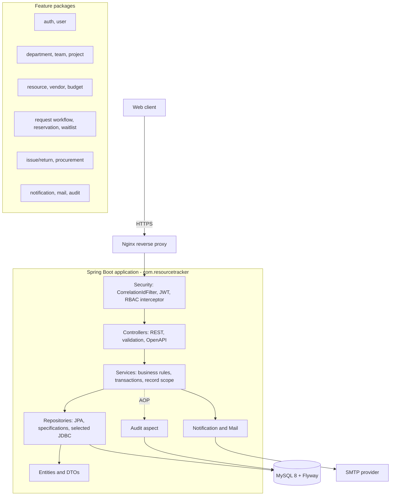
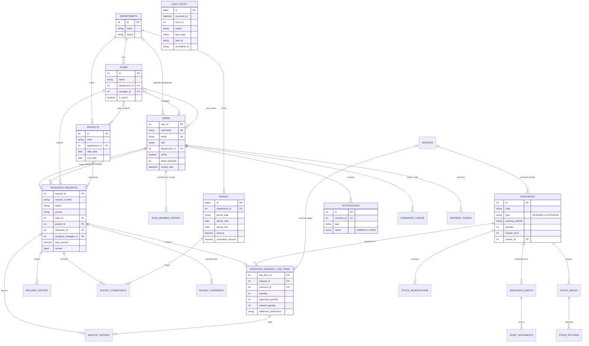
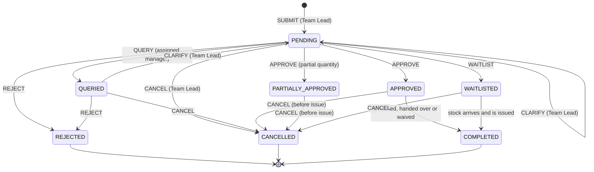
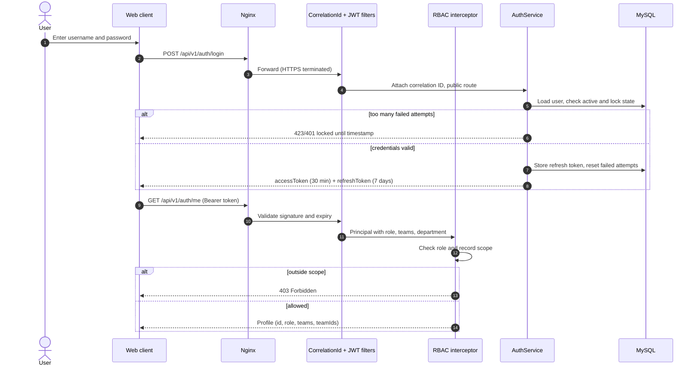
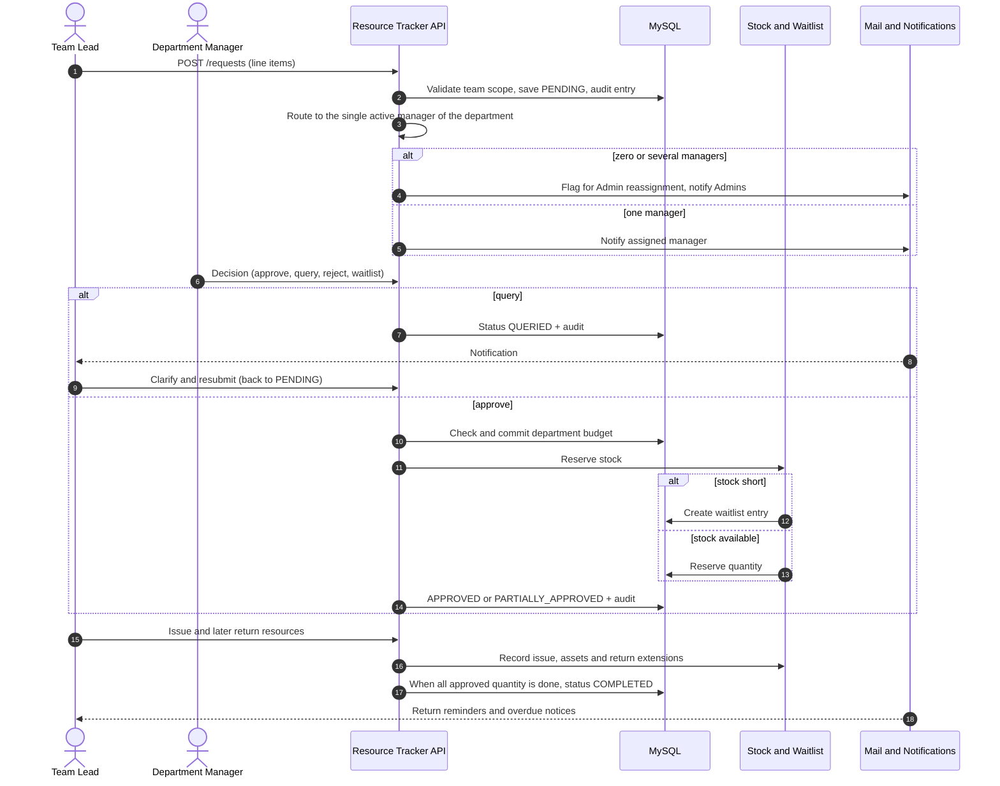
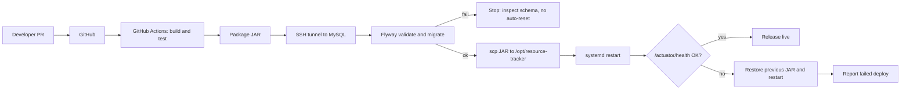

# Resource Tracker – Architecture Diagrams

How this set fits together (each diagram uses the tool that expresses it best):

| View | Diagram | Tool |
|---|---|---|
| System context, containers, components, deployment | C4 model | Structurizr DSL (`workspace.dsl`) |
| 1. Layers and feature packages | Layered architecture | Mermaid flowchart |
| 2. Data model | ERD | Mermaid `erDiagram` |
| 3. Request lifecycle | State machine | Mermaid `stateDiagram-v2` |
| 4. Authentication and security chain | Sequence | Mermaid `sequenceDiagram` |
| 5. Request-to-fulfilment flow | Sequence | Mermaid `sequenceDiagram` |
| 6. CI/CD and release | Flowchart | Mermaid flowchart |

Mermaid renders natively on GitHub, GitLab and most Markdown viewers.

---

## 1. Layers and feature packages

---

## 2. Data model (core entities)

`audit_entry` has no foreign keys by design: it is an append-only, trigger-protected trail keyed by `item_type` + `item_id`.

---

## 3. Request lifecycle (state machine)

Derived from `RequestTransitions`, the single source of truth for who may move a request.

---

## 4. Authentication and security chain

---

## 5. Request-to-fulfilment flow

---

## 6. CI/CD and release

